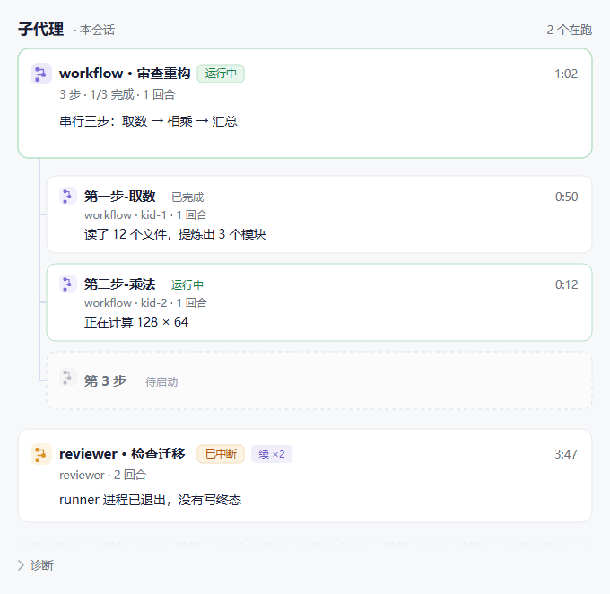

<p align="center">
  
</p>

<h1 align="center">子代理面板</h1>

<p align="center">
  <b>subagents-board</b> · pi-app 桌面端插件<br>
  <sub>在右栏看清 <code>pi-subagents</code> 的后台运行 —— 谁在跑 · 跑到哪 · 什么时候结束 · 要不要插手</sub>
</p>

<p align="center">
  <a href="CHANGELOG.md"></a>
  <a href="LICENSE"></a>
  <a href="test"></a>
  
  
</p>

---

> **需要带插件宿主的 pi-app。** 插件系统目前只在这个 fork 里：
> [`hotsnow-sean/pi-app`](https://github.com/hotsnow-sean/pi-app)。上游
> [`justhil/pi-app`](https://github.com/justhil/pi-app) 还没有——官方版没有「设置 → 插件」这一页。
> 安装包直接下 [最新 release](https://github.com/hotsnow-sean/pi-app/releases/latest)（`0.7.7-fork.4` 起）。

## 面板长什么样

<p align="center">
  
</p>

<p align="center"><sub>父卡下面挂着三个子代理；再下面那张是被中断后重试过两次的 <code>reviewer</code></sub></p>

## 为什么需要它

子代理默认以后台方式跑（`asyncByDefault: true`），结果不进父会话的工具详情。也就是说，派出去之后**它跑得怎么样、什么时候结束，在界面里完全看不见**——只能等它回来。

这个插件把那段运行状态接到右栏，顺带补齐两个缺口：**能看见**（代际链、子代理明细、终止原因）和**能插手**（对后台 run 插话、停止）。

## 它显示什么

- 谁在跑（`worker` / `reviewer` / 自定义 agent 名）、什么状态、跑了多久
- 每个 run 的 children（并行 / 链式 / workflow 下的多个子代理），各自的模型与 thinking 档位
- 终止态的原因：成功 / 失败 / 被停止 / 被中断（应用重启把 runner 进程带走了），以及扩展给出的摘要
- 代际链：`resume` 出来的新一段会挂在同一张卡上（「续 ×N」），不会变成两张卡
- **点一下子代理行 → 只读预览那段子会话**（不能在里面发消息；想接手就从侧栏切过去）
- **插手**：对**后台 run** 插话（立刻生效 / 本轮结束后再说）与停止；回执区分「已送达」与「已排队」
- **信箱**：run 结束时投一条「worker 已完成」到顶栏信箱，点开回到产出它的会话 + 右栏面板
- **历史**：应用重启或实例退出后，那批卡不会消失——闲置一段时间的记录会自动归档，保留 30 天

## 干预的边界

- 只对**后台**（async）run 有效。前台子代理没有可跟踪的 id，只能用 Esc 停整轮——面板上不会出现按钮。
- 已经结束或已停止的段不出现按钮，不会让人点了才看到报错。
- **插话排队 ≠ 它已经看到**：只说明排上了队，子代理这一轮结束才会读到；也不会中断正在跑的命令。
- **停止不可逆**：停掉的 run 不能接着跑，只能重新派一个。点完之后会有一小段「停止中」，要等它真的收尾。
- 留言超过 **2 分钟**作废：插话是即时动作，几分钟后才送到的消息多半只会撞上一个已经结束的 run。

## 看不到的信息

有些东西 `pi-subagents` 自己就没有暴露，面板不会用空位硬凑——一直显示 `—` 比不显示更像坏了。

- 任务原文（事件里已经抹掉）
- 子代理此刻在跑哪个工具（只有轮次和工具计数）
- 「它在等父会话回答」这类状态（扩展没有这个信号）

除此之外，面板也不弹任何横幅。「数据旧了」不提示——切换会话、重启应用都会让后台换一代，
那是正常生命周期，看到了也没有可做的事。

只有当它确实连不上、或者退化成轮询时，才会在面板上说明一句：

| 提示 | 什么时候 | 要不要管 |
|---|---|---|
| 「未连上 pi-subagents」 | 握手一直没成功（没装 / 版本不对 / 还没就绪） | 装好并启用扩展，会自动恢复 |
| 「轮询模式」 | 事件通道不可用，改成定时读一次状态 | 数据完整，只是慢一拍 |
| 空态「还没有子代理运行记录」 | 这个会话确实没派过 | 派一个就有了 |

## 安装

1. 宿主里装好 `pi-subagents` 并启用（`pi install npm:pi-subagents`）
2. pi-app：**设置 → 插件 → 安装插件…**，选中本仓库根目录
3. **新开一个会话**生效（插件扩展随 worker 启动注入，已开着的会话还挂着旧 worker）

装完右栏会出现「子代理」面板。没有任何子代理在跑时，面板显示空态，不会留下文件。

> **装插件 = 把宿主进程的权限交出去。** `main.mjs` 是被直接 `import` 进 pi-app 主进程运行的，
> `node:fs`、`child_process`、Electron API 全都在手。本插件只用这些权限读写自己的
> `plugin-data/` 目录，全部代码就在这个仓库里、可自行审阅——但宿主目前不会替你担保这一点。

## 依赖

- 带插件宿主的 pi-app（见顶部说明），版本不低于 `0.7.7-fork.4`
- 宿主里已安装并启用 `pi-subagents` 扩展

插件依赖宿主较新的插件 API（子会话只读预览、会话实时读取、后台状态采集）。老一点的宿主
即使能装上，面板也不会有数据。

## 数据与隐私

全部在本机，没有任何网络请求。

- 可写目录只有 `<userData>/plugin-data/subagents-board/`（宿主分配给插件的数据目录）
- 里面是三样东西：运行状态、一次性指令与回执、「这条 run 已经通知过」的台账
- 运行状态闲置 1 小时后归档，**30 天**后自动清理
- 会话文件只读不写：预览走宿主的只读视图，插话走扩展自己的接口，**不碰别人的会话文件**

## 工作方式

```
pi-subagents（worker 进程内）
      ↕ 读取运行状态 / 投递插话与停止
agent.mjs（worker 进程里的扩展）
      ↓ 写运行状态    ↑ 读指令、写回执
main.mjs（main 进程）
      ↕ 合并状态、归档、给面板供给数据
ui/（sandbox iframe 面板）
```

worker 与 main 之间没有插件能用的 IPC，所以两个方向都靠数据目录里的文件传递。顺带的好处
是数据落在磁盘上，应用重启之后历史还在。

插话就是对某个 run 的一次即时留言：面板写一条留言，worker 读到后交给扩展，再把回执写
回来——不做复杂的投递状态机。

## 开发

```bash
npm test        # node:test：纯函数、落盘、优先级合并
```

零依赖，纯 ESM。调试时把宿主指向「装着插件目录的父目录」：

```bash
PI_PLUGINS_DIR=/path/to/pi-plugins-dev PI_PLUGINS_DIR_SOURCE=dev npm run dev
```

宿主会扫这个目录下的每个子目录找 `plugin.json`，所以仓库本身要放在某个父目录里（例如 `pi-plugins-dev/subagents-board`）。`PI_PLUGINS_DIR_SOURCE=dev` 让设置页把它标成「本地开发」而不是「内置」。

改 `main.mjs` / `ui/` 走宿主热重载（按插件目录最大 mtime）；改 `agent.mjs` 需要新会话——它在 worker 里，随会话创建加载一次。

几个实现上的取舍：

- **`engines['pi-desktop']` 写 `>=0.7.7-0`**：宿主 fork 的版本号带 prerelease 后缀
  （如 `0.7.7-fork.4`），在 semver 里小于 `0.7.7`；写成 `>=0.7.7` 会让宿主播过这个插件。
- **每个实例写自己的文件**（`<pid>-<startedAt>.json`）：会话切换会让扩展换代、state 清空，
  而写盘是整份覆盖——共用文件名的话，第一次保存就把上一代清掉。
- **还要核对 run 自己的 `status.json`**：worker 会换代、会死、会漏掉最后一次事件。main 一直
  活着，每轮顺手核对一遍——进程已不在而 status 还写着 running 的段判成「被中断」。

## 目录结构

| 路径 | 是什么 |
|---|---|
| `agent.mjs` | worker 侧的 pi extension：订阅事件、维护状态、落盘、执行插话/停止 |
| `main.mjs` | main 侧服务：合并状态、自愈、长轮询、信箱巡检、归档巡检 |
| `lib/lineage.mjs` | 代际链合并、跨代自愈（纯函数） |
| `lib/live-store.mjs` | 落盘布局、原子写、装订归档、读侧版本校验 |
| `lib/run-snapshot.mjs` | 读上游 run 产物（`status.json` / `events.jsonl` / 启动描述符），带缓存 |
| `lib/degrade.mjs` | 「这份数据能不能信」的判定（纯函数） |
| `lib/inbox-watch.mjs` | 信箱巡检：哪些 run 值得通知、通知长什么样（纯函数） |
| `lib/note-queue.mjs` | 插话/停止的一次性指令与回执（纯函数 + 目录约定） |
| `ui/` | 面板：sandbox iframe，通过宿主下发的桥 `window.pi` 通信 |
| `docs/` | 设计稿与 UI 原型（面向开发，不是用户文档） |

## 版本

变更记录见 [CHANGELOG.md](CHANGELOG.md)。当前 `0.11.x`。

已知限制：只能观测**后台** run；前台子代理没有可跟踪的 id，看不到也管不了。状态变化正常
立刻可见，万一漏了事件，6 秒内也会补上。

## 许可

MIT
