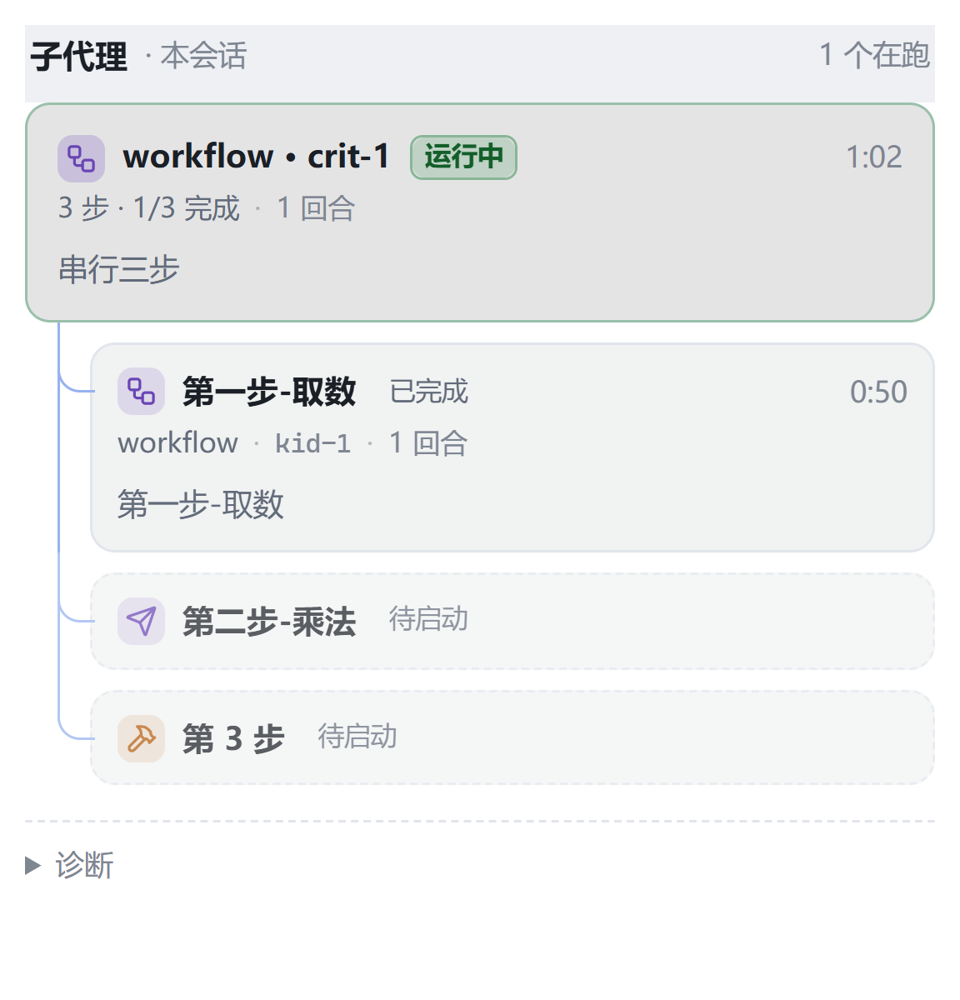

# 子代理面板 · subagents-board

[pi-app](https://github.com/hotsnow-sean/pi-app) 桌面端插件：在**右栏**看清 [`pi-subagents`](https://www.npmjs.com/package/pi-subagents) 的后台运行。



## 为什么需要它

子代理默认以后台方式跑（`asyncByDefault: true`），结果不进父会话的工具详情。也就是说，派出去之后**它跑得怎么样、什么时候结束，在界面里完全看不见**——只能等它回来。

这个插件把那段运行状态接到右栏，顺带补齐两个缺口：**能看见**（代际链、子代理明细、终止原因）和**能插手**（对后台 run 插话、停止）。

## 它显示什么

- 谁在跑（`worker` / `reviewer` / 自定义 agent 名）、什么状态、跑了多久
- 每个 run 的 children（并行 / 链式 / workflow 下的多个子代理），各自的模型与 thinking 档位
- 终止态的原因：成功 / 失败 / 被停止 / 被中断（应用重启把 runner 进程带走了），以及扩展给出的摘要
- 代际链：`resume` 出来的新一段会挂在同一张卡上（「续 ×N」），不会变成两张卡
- **点一下子代理行 → 只读预览那段子会话**（不绑 worker、不能发消息；想接手自己从侧栏切过去）
- **插手**：对**后台 run** 插话（立刻生效 / 本轮结束后再说）与停止；回执区分「已送达」与「已排队」
- **信箱**：run 结束时投一条「worker 已完成」到顶栏信箱，点开回到产出它的会话 + 右栏面板
- **历史**：实例退出后，那批卡不会消失——闲置 1 小时的分区会被装订归档，保留 30 天

## 干预的边界

- 只对**后台**（async）run 有效。前台子代理没有 async id，只能用 Esc 停整轮——面板上不会出现按钮。
- 已终态 / 已停止的段也不出现按钮：先置灰，别让用户点了才看到报错。
- **插话的 `queued` 不等于「它已经看到」**：只说明排上了队，子代理本轮结束才会读到；
  排队中的插话也不会取消正在跑的 shell 命令。
- **停止不可逆**：`stopped` 的 run 不能 resume（扩展明确），只能重新派一个。回执的
  `state: "stopping"` 只代表受理，真正终止要靠 status 收敛，所以面板会自己再拉一次状态。
- 留言超过 **2 分钟**就作废（不投递，只记一条过期回执）：steer 是即时动作，隔几分钟才送到的插话多半只会撞上已经终态的 run。

## 它不显示什么

字段诚实原则——下面这些 RPC 确实拿不到，所以界面上不留空位（留了就会永远显示 `—`，比不显示更像坏了）：

- 任务原文：事件载荷里是 `[prompt redacted]`
- 当前在跑哪个工具：`status` 只给 `activity.turnCount` / `toolCount` 与 `lastActivityAt`
- 「子代理在等父会话回答」：`status` 里没有任何 `wait*/pending*/supervisor*` 字段

面板只在三种情况下给出提示，其余一律静默：

| 提示 | 什么时候 | 要不要管 |
|---|---|---|
| 「未连上 pi-subagents」 | 握手一直没成功（没装 / 版本不对 / 还没就绪） | 装好并启用扩展，会自动恢复 |
| 「轮询模式」 | 事件通道不可用，退化成每 2 秒读一次状态 | 数据完整，只是慢一拍 |
| 空态「还没有子代理运行记录」 | 这个会话确实没派过 | 派一个就有了 |

「数据旧了」不提示。写数据的是 worker，切换会话 / 换工作区 / 重启应用都会让它换代——那是正常生命周期，用户面对的自始至终是同一个会话，看到了也没有可执行的动作。

## 安装

1. 宿主里装好 `pi-subagents` 并启用（`pi install npm:pi-subagents`）
2. pi-app：**设置 → 插件 → 安装插件…**，选中本仓库根目录
3. **新开一个会话**生效（插件扩展随 worker 启动注入，已开着的会话还挂着旧 worker）

装完右栏会出现「子代理」面板。没有任何子代理在跑时，面板显示空态，不会留下文件。

## 依赖

- pi-app 桌面端 `>= 0.7.7`（需要插件的 `agent` 注入、`ctx.sessions.reveal`、会话实时预览）
- 宿主里已安装并启用 `pi-subagents` 扩展

> `engines['pi-desktop']` 写的是 `>=0.7.7-0` 而不是 `>=0.7.7`：宿主 fork 版本号带 prerelease
> 后缀（如 `0.7.7-fork.3`），在 semver 语义里**小于** `0.7.7`。写成 `>=0.7.7` 会让 fork 版
> 宿主把插件判成不兼容并静默跳过（设置页只显示一行「不满足版本要求」）。

## 数据与隐私

全部在本机，没有任何网络请求。

- 插件私有的可写目录：`<userData>/plugin-data/subagents-board/`（宿主的 `ctx.dataDir`）
- `live/` 是运行状态，`inbox/` 与 `receipts/` 是插话与停止的一次性指令与回执，`notified.json` 是「这些 run 已经通知过了」的台账
- 保留期：分区闲置 1 小时且段全部结束 → 装订进 `live/<sessionKey>/archive.json`；归档段保留 **30 天**后清理
- 会话文件本身只读不写：预览走宿主提供的只读视图，插话走扩展的 `steer` RPC，**不碰别人的会话文件**

## 它是怎么工作的

```
pi-subagents（worker 进程内）
      ↕ eventBus RPC（subagents:rpc:v1:*）
        读：ping / status / 事件          写：steer / stop
agent.mjs（worker 进程，宿主注入的 pi extension）
      ↓ 原子写 <dataDir>/live/<sessionKey>/<pid>-<startedAt>.json
      ↑ 读 <dataDir>/inbox/<sessionKey>/<id>.json，执行后写 receipts/<id>.json
main.mjs（main 进程）
      ↓ 把闲置分区装订进 live/<sessionKey>/archive.json
      ↕ 面板通过桥 invoke('getState' | 'note' | 'stop' | …)
ui/（sandbox iframe）
```

三件事值得说明：

**为什么两个方向都走文件。** main 与 worker 之间没有插件可用的 IPC 通道。文件是唯一的公共面，也顺带带来一个好处：数据在磁盘上，应用重启后历史还在。

**为什么每个实例写自己的文件。** 会话切换会让插件扩展**换代**（工厂重新调用、state 清空），而写盘是整份覆盖。共用文件名的话，第一次保存就把上一代清空。所以 `<pid>-<startedAt>.json` 一人一份，读的时候合并。

**为什么还要读 run 自己的 `status.json`。** worker 会换代、会死、会漏掉最后一次 `async-complete`。main 一直活着，每轮取状态时顺手拿 `status.json` 核对一遍——它是地面真相。进程已经不在而 status 还写着 `running` 的段会被判成「被中断」（按 pid 判，不做「多久没更新就判死」：静默长思考是正常的）。

「插话」= 对某个 run 的一次 steer：面板写一条不可变的 note，worker 里的 agent 读到后调扩展的 `steer` RPC（`{ id, message, mode }`），把扩展返回的 steering 收据写成回执。不自己实现投递状态机、不做双端死线。

## 开发

```bash
npm test        # node:test：纯函数、落盘、优先级合并
```

零依赖，纯 ESM。调试时把宿主指向「装着插件目录的父目录」：

```bash
PI_PLUGINS_DIR=/path/to/pi-plugins-dev PI_PLUGINS_DIR_SOURCE=dev npm run dev
```

宿主会扫这个目录下的每个子目录找 `plugin.json`，所以仓库本身要放在某个父目录里（默认 `pi-plugins-dev/subagents-board`）。`PI_PLUGINS_DIR_SOURCE=dev` 让设置页把它标成「本地开发」而不是「内置」。

改 `main.mjs` / `ui/` 走宿主热重载（按插件目录最大 mtime）；改 `agent.mjs` 需要新会话——它在 worker 里，随会话创建加载一次。

## 目录结构

| 路径 | 是什么 |
|---|---|
| `agent.mjs` | worker 侧的 pi extension：订阅事件、维护状态、落盘、执行插话/停止 |
| `main.mjs` | main 侧服务：合并状态、自愈、长轮询、信箱巡检、归档巡检 |
| `lib/lineage.mjs` | 代际链合并、跨代自愈（纯函数） |
| `lib/live-store.mjs` | 落盘布局、原子写、装订归档、读侧版本校验 |
| `lib/run-snapshot.mjs` | 读上游 run 产物（`status.json` / `events.jsonl` / 启动描述符），带缓存 |
| `lib/degrade.mjs` | 「这份数据能不能信」的判定（纯函数） |
| `lib/inbox-watch.mjs` | 信箱巡检：哪些 run 值得通知、通知长什么样（纯函数） |
| `lib/note-queue.mjs` | 插话/停止的一次性指令与回执（纯函数 + 目录约定） |
| `ui/` | 面板：sandbox iframe，通过宿主下发的桥 `window.pi` 通信 |
| `docs/` | 设计稿与 UI 原型（面向开发，不是用户文档） |

## 版本

变更记录见 [CHANGELOG.md](CHANGELOG.md)。当前 `0.11.x`。

已知限制：

- 只能观测**后台** run；前台子代理没有 async id，看不到也管不了
- 宿主没给插件扩展提供 dispose 钩子，所以插件实例只能靠「继续用 `pi` 会抛 stale」发现自己作废——在那之前它的定时器还在跑（无害，但白转）
- 面板每 6 秒一次长轮询兜底。宿主提供事件推送后会换成推送为主（见 CHANGELOG 的讨论）

## 许可

MIT
